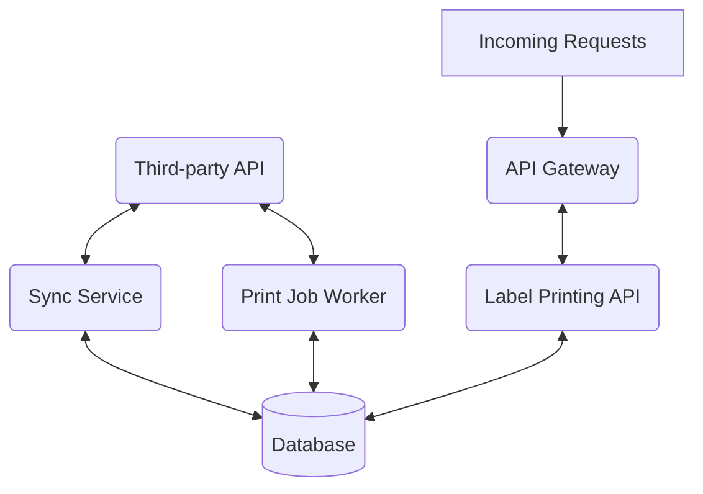
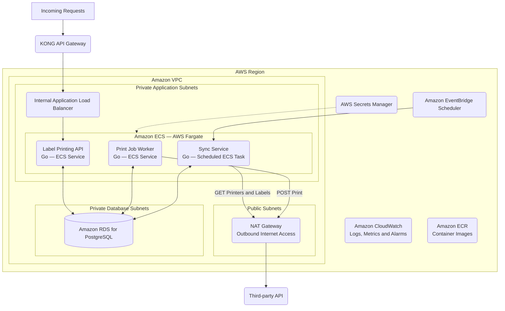
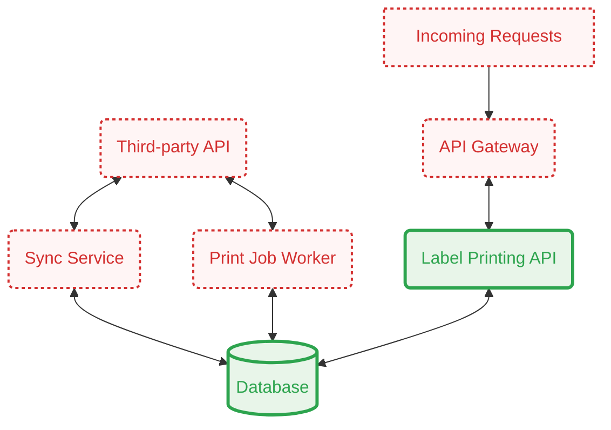
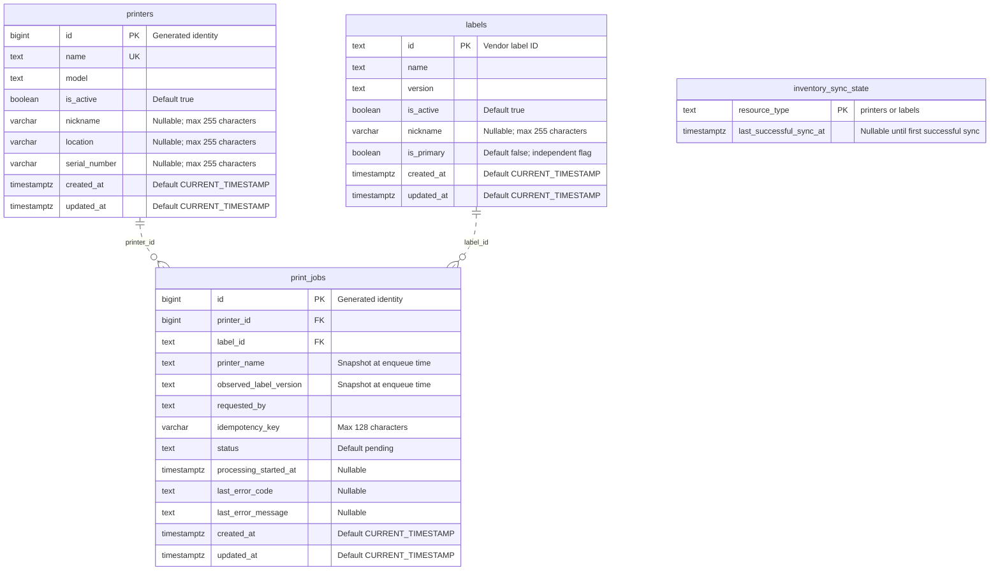

# Solution for Interview Case Study

This document explains my solution for the case study.

## API Specification

After reading the case study, the first step I took for solving it was to design the API spec with the endpoints needed to meet the requirements.

Users should be able to:

- Update metadata of printers (nickname, location and serialNumber)
- Query all printers
- Update metadata of labels (nickname and isPrimary)
- Query all labels

The proposed endpoints use the `/v1` base path.

| Method | Endpoint                | Purpose                                        |
| ------ | ----------------------- | ---------------------------------------------- |
| GET    | `/printers`             | List active printers with metadata             |
| PATCH  | `/printers/{printerId}` | Update printer metadata                        |
| GET    | `/labels`               | List active labels with metadata               |
| PATCH  | `/labels/{labelId}`     | Update label metadata                          |
| POST   | `/print-jobs`           | Submit a print job for asynchronous processing |

For details on the schema proposed for the API check the [specification here](./spec.yaml).

### Pagination

Pass `nextCursor` from the previous response to fetch active printers with a greater ID.

For example, with active IDs `[1, 3, 5]` and `limit=2`, the first page returns `[1, 3]`.
If printer `1` is deactivated, the active list becomes `[3, 5]`. An offset of 2 would skip
both remaining printers. Passing `cursor=3` returns printer `5`.

## High Level Architecture

The main decisions that I had to make before desigining the architecture for the system were:

### Keep copy of vendor data or call their API in every request?

| Aspect               | Keep a local copy                                                  | Call the vendor on every inventory request                          |
| -------------------- | ------------------------------------------------------------------ | ------------------------------------------------------------------- |
| **Freshness**        | Data may be temporarily stale between successful synchronizations. | Data is as fresh as the vendor’s response.                          |
| **Availability**     | Can serve the last known inventory during vendor outages.          | Inventory queries depend on the vendor being available.             |
| **Response time**    | Predictable database reads without a vendor request.               | Includes the vendor’s response time.                                |
| **Vendor traffic**   | Controlled by the synchronization interval.                        | Increases with client request volume.                               |
| **Implementation**   | Requires synchronization, reconciliation, and monitoring.          | Simpler: fetch vendor inventory and combine it with local metadata. |
| **Resource changes** | Additions and removals appear after synchronization.               | Changes appear when the vendor returns them.                        |

_Decision:_ Keep a local copy of vendor inventory in Database and synchronize it in the background.

### Use an external Queue service or use DB as queue?

| Aspect                     | External queue service                                                        | Database as the queue                                              |
| -------------------------- | ----------------------------------------------------------------------------- | ------------------------------------------------------------------ |
| **Infrastructure**         | Adds a queue service, permissions, and delivery configuration.                | Reuses the database already required by the platform.              |
| **Job persistence**        | Coordinating database writes and message publication requires care.           | Job creation and enqueueing can happen in one transaction.         |
| **Local development**      | Requires access to the service or an emulator.                                | Uses the existing local database.                                  |
| **Delivery and retries**   | Typically provides message reservation, redelivery, and dead-letter handling. | Processing coordination and recovery behavior must be implemented. |
| **Monitoring and scaling** | Usually provides queue metrics that simplify worker autoscaling.              | Requires application metrics for backlog and waiting time.         |
| **Load isolation**         | Queue storage and delivery scale independently of the application database.   | Queue activity shares database capacity with other operations.     |

**Decision:** Start with Database as the queue to keep the system simple and facilitate local development. We can save and queue a print job in one transaction. Revisit external queue if managing retries or worker autoscaling becomes too complex, or if queue traffic starts competing with other database operations.

### Proposal

Based on these decisions, the following is a high level architecture diagram of the proposed solution:



## Assumptions

- API is exposed via organization API Gateway (for example KONG)
- Authorization is handled by organization API Gateway
- Gateway is configured to set the internal `X-Requested-By` header to the verified subject ID (`sub`) from the organization's identity provider.
- No access control on resource level:
  - All users that have access to the API are allowed to fetch and manage the metadata for the whole fleet of printers and labels, and can also submit jobs to any active printer and any active label
- Printer names in the vendor system are unique

## Cloud Archicture and Tech Stack

The proposed solution uses AWS, Go, and PostgreSQL. These technologies were chosen primarily because of developer familiarity, allowing more attention to the requirements, implementation, and architectural tradeoffs.

| Area                   | Technology               | Role                                                               |
| ---------------------- | ------------------------ | ------------------------------------------------------------------ |
| Cloud platform         | AWS                      | Hosts the API, synchronization service, print worker, and database |
| Application hosting    | ECS with Fargate         | Runs the application containers without managing servers           |
| Programming language   | Go                       | Implements the REST API and background processes                   |
| Database               | PostgreSQL on Amazon RDS | Stores inventory, metadata, and print jobs; also acts as the queue |
| Scheduling             | EventBridge Scheduler    | Periodically starts inventory synchronization                      |
| Observability          | CloudWatch               | Collects application logs, metrics, and alarms                     |
| Infrastructure as code | Terraform                | Defines reproducible cloud infrastructure                          |

### System Architecture



## Implementation



| Method | Endpoint                | Implemented |
| ------ | ----------------------- | ----------- |
| GET    | `/printers`             | ✅          |
| PATCH  | `/printers/{printerId}` | ✅          |
| GET    | `/labels`               | ✅          |
| PATCH  | `/labels/{labelId}`     | ✅          |
| POST   | `/print-jobs`           | ✅          |

## Data models

The following is the relationship diagram of DB tables created:



Since no Third-party vendor API exists, I have decided to [seed](./migrations/000000_seeds.sql) the database in a way that it simulates a sucessful syncronization between system's DB and the vendor backend.

## How to run locally

### Setup local DB

Requires Docker with Compose. Start PostgreSQL, apply the schema once, then seed:

```sh
docker compose up -d --wait postgres
```

```sh
docker compose exec -T postgres psql -U postgres -d labelling -v ON_ERROR_STOP=1 < migrations/000001_initial.up.sql
```

```sh
docker compose exec -T postgres psql -U postgres -d labelling -v ON_ERROR_STOP=1 < migrations/000000_seeds.sql
```

### Start API

With Go 1.25 or later, run these commands from the repository root. Copy the example once to use the local Compose database.

```sh
cp .env.example .env
go run ./cmd/api
```

The API reads `.env` from its working directory if present. An exported `DATABASE_URL` takes precedence. The API requires this setting and checks the database connection before listening on port 8080 by default.

### Local Swagger UI

To enable interactive docs, start the API from the repository root with the docs flag.

```sh
go run ./cmd/api -docs -addr 127.0.0.1:8080
```

Open [Swagger UI](http://127.0.0.1:8080/docs) and choose **Try it out** on an operation. The page loads Swagger UI assets from a CDN and reads the repository's `spec.yaml` at `/openapi.yaml`. For print jobs, the local page supplies `X-Requested-By: local-developer` to simulate Kong. Both documentation routes are disabled by default.

### Check the code

The tests use `DATABASE_URL` from the shell or the repository's `.env`, in that order. If neither supplies a URL, they use the local Compose server. The configured user must be able to create databases. Each scenario runs its migration and queries in a temporary database and drops it afterward.

```sh
docker compose up -d --wait postgres
go build ./...
go vet ./...
go test -count=1 ./...
```

#### Build container images

One Dockerfile builds each entry point. The `APP` build argument is required.

```sh
docker build --build-arg APP=api -t labelling-api .
docker build --build-arg APP=sync -t labelling-sync .
docker build --build-arg APP=worker -t labelling-worker .
```
